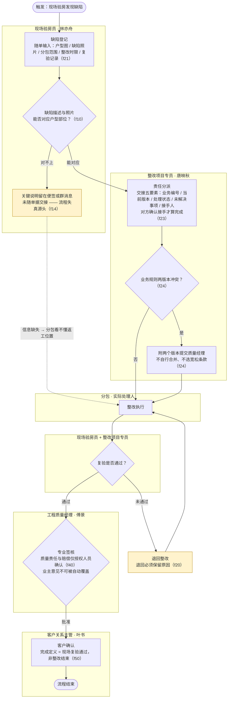
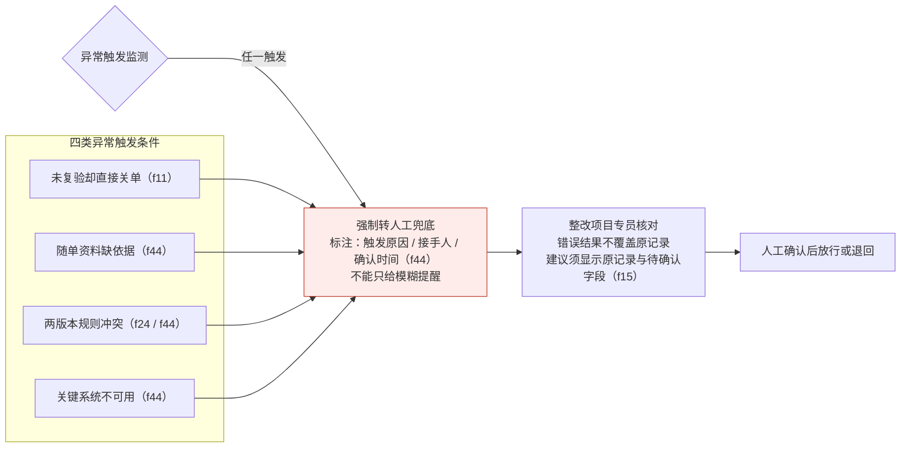
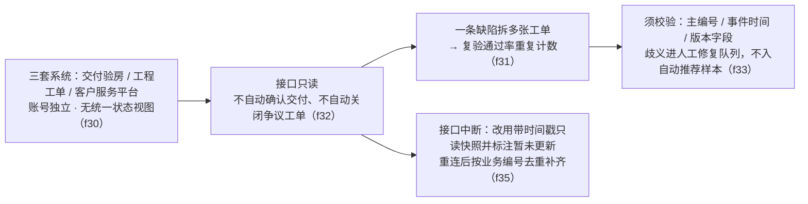

# 现状流程图与异常路径（任务 2 交付）

> 对应任务：还原现状流程 —— 画出触发、输入、交接、人工判断、输出及异常路径，在瓶颈处标明责任人。
>
> 说明：事实编号 f00–f55 对应访谈记录。所有结论均属**待验证假设**；合成训练不代表真实授权、业务执行或客户验收。
>
> 本文件使用 Mermaid 绘制，GitHub 仓库页面会自动渲染成图；本地可用 VS Code（安装 Mermaid 插件）或 <https://mermaid.live> 查看。

## 1. 现状主流程（六角色泳道视图）

## 2. 异常路径（四类触发 → 强制人工兜底，f11 / f15 / f44）

## 3. 系统与数据约束（平台侧 · 秦芮）

## 4. 瓶颈与责任标注

| 环节 | 瓶颈 / 口径缺口 | 责任人 | 事实编号 |
| --- | --- | --- | --- |
| 缺陷登记 | 照片与户型部位对不上；关键说明不随单交接 | 林亦舟 | f10 / f14 |
| 全流程 | 各节点等待 / 处理时间未分开量 → 整改周期下降无法归因 | 顾明岚（定口径） | f01 |
| 责任分派 | 交接须对方确认，仅发消息不算完成 | 唐映秋 | f23 |
| 复验 / 关单 | 「未复验关单为零」是红线；系统能否按角色阻断关单未核实 | 傅景 / 秦芮 | f42 / f30 / f32 |
| 验收口径 | 98% 是**缺陷定位准确率**（非归类正确率），判定人与样本量未定 | 顾明岚 + 傅景 | f02 / f42 |
| 客户确认 | 完成定义冲突：施工 = 整改结束 vs 客户 = 复验通过 | 叶书（牵头对齐，顾明岚拍板） | f50 |

## 5. 只能由人完成的判断

1. 专业签核（整改专员不能代替，f22）
2. 质量责任与赔偿确认（f40）
3. 规则冲突裁决：附两版本交质量经理，不自行合并（f24）
4. 异常转人工并标注触发原因 / 接手人 / 确认时间（f44）
5. 客户签字与对外承诺（敏感资料仅授权岗位可见，f41 / f52）

---

*理想流程（资料随单、交接确认、复验授权后关单）与现场做法（便签补说明、照片部位错配、未复验直接关单、完成定义不一致）的差异根源是**基础流转规则与数据口径未统一**，而非是否使用 AI。试点前仅做只读回放，不回写工单。*
